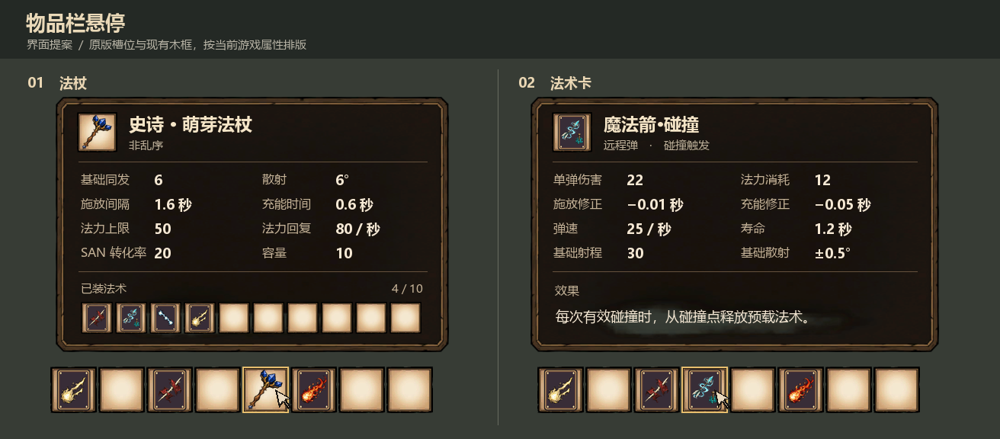
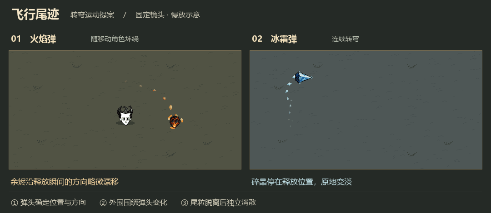
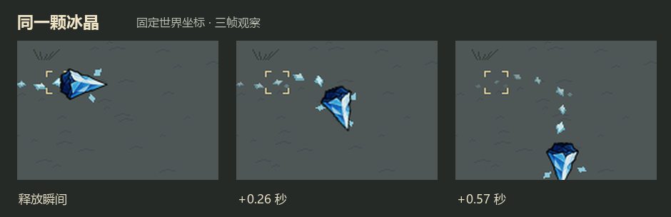
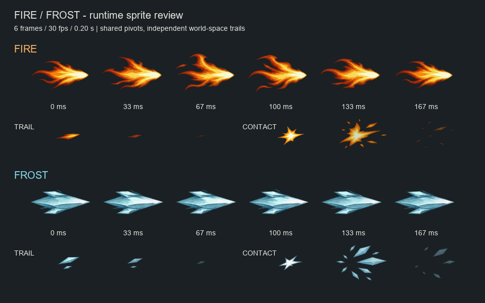
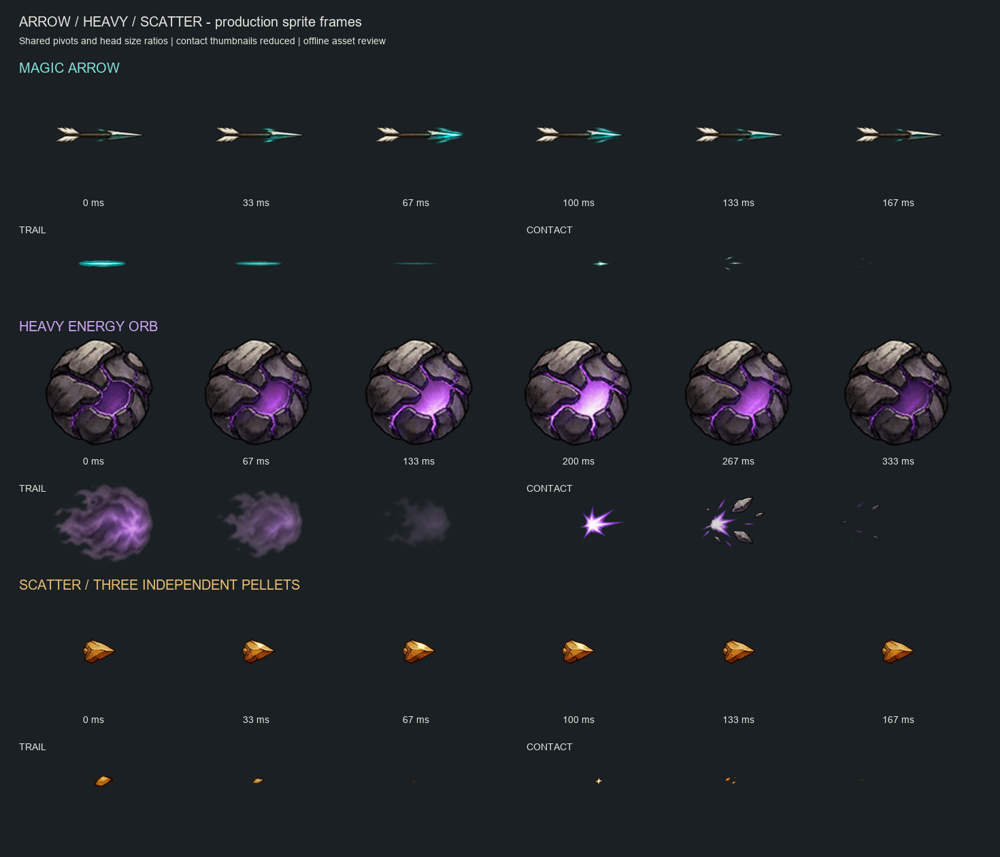
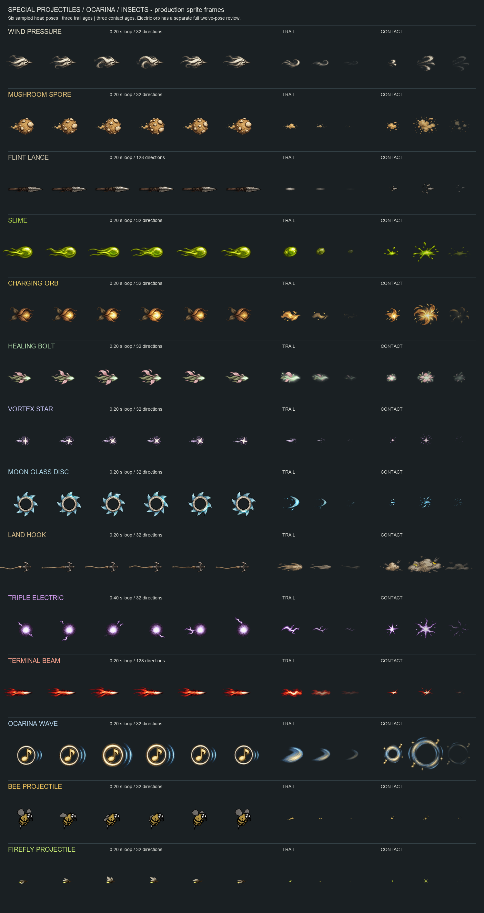

# 物品悬停面板与飞行尾迹

本轮交付效果图，作为后续开发的评审依据。面板预览用运行贴图离线排版；尾迹概念图用于选择轮廓和配色，动图用于判断游戏大小下的节奏。三者均为设计预览。

## 01 · 物品栏悬停面板（0.16.6 已实装）



- [x] 法杖与法术卡各完成一张排版示例，使用编辑栏现有的九片木框、原版格子和实际物品图标。
- [x] 实现共用面板。标题放真实物品图标与名字，法术卡副标题放类型，杖副标题放乱序状态。属性分两列，名称与数值有固定对齐线。卡名沿用纯法术名。
- [x] 法杖展示同发、散射、施放间隔、充能时间、法力上限、法力回复、SAN 转化率和容量。有固有法术时单列。下方横排显示全部实际槽位、空格和已装数量。示例为种子 1062 的十格杖，演示配装依次为穿透、魔法箭·碰撞、连锁闪电、火花弹。
- [x] 法术卡优先展示伤害、耗蓝、施放及充能修正，再放适用的速度、寿命、射程、散射与效果。修饰卡用对应加成取代弹速等无关字段；瞬发、近战、连锁、多弹分别使用适合它们的伤害说明。保留正负号与单位。
- [x] 优先在被指向格子上方显示。空间不足时翻到下方并限制在屏幕内，鼠标所在格始终完整可见。物品栏面板只读，不截获物品点击、拖放或右键；靠台换卡仍在手持编辑栏进行。
- [x] 联机端继续使用服务端同步的杖数据和卡槽编码。若需要结构化属性，定义统一展示字段，避免客户端拆解中文格式串猜数值。

验收时分别检查 2、7、12 格杖，一张长说明修饰卡、一张瞬发卡和一张碰撞卡。覆盖物品栏最左、最右、背包侧栏和高 HUD 缩放。检查固定角部、水平槽位、无白边、文字不截断；快速切换物品、关闭背包或移出鼠标时无旧面板残留。

开启开发者选项后，在远程控制台用 `nw_hudkit()` 领取 2、7、12 格法杖，用 `nw_card("arrow_hit")` 和 `nw_card("chain")` 对照触发和瞬发说明。客户端实机还需确认字体、HUD 缩放以及背包边缘位置。

## 02 · 远程投射物动态效果

### 2026-11-09：客户端统一尾迹预算（当前实现）

全客户端尾迹总额默认1700，可选择不限。模组设置「客户端尾焰总上限」当前提供不限、100、500、900、1300、1700、2100、2500、2900、3300；向导「个人设置」允许每位玩家独立调整并保存到本机，未保存个人选择时读取模组初始配置，不由服务器强制同步。火花、元素定时尾迹、魔法箭／燧晶投枪的空间尾迹以及橙色光弹共用一个计数，包含所有玩家的尾迹，取代下文历史实现中的 96／128／256／384 段独立全局预算。

2026-11-10 更新：限额模式改为生成前准入检查，不再删除旧尾段给新尾段腾位置。所有尾焰共用同一客户端活动总数：总数达到设置值的 75% 时，跳过其他玩家或无归属的新尾段；达到完整设置值时，自己的新尾段也跳过。例如设置 1000，非自己从 750 起停止新增，自己从 1000 起停止新增。两个门槛都比较全局总数，不是各玩家各自的计数。已有尾段继续自然消散，空位释放后恢复生成；动态调低上限也不主动删除已有尾段。

统一管理器为 `nw/trail_budget.lua`。火花、元素定时／空间尾迹及橙色光弹均在创建实体和重用槽位之前检查；拒绝时不创建、不删除，也不刷新旧尾段寿命。发射采样时钟与路径仍前进，不积压被跳过的采样来事后补发。删除原先的最小堆、出生次序排序和归属索引，只维护活动集合与计数，检查与登记均为 O(1)。弹体仍同步施法者 ID，每次尝试生成时与当前 `ThePlayer.userid` 比较，自动接纳晚到的归属信息；尾段是纯本地实体。默认不限，各类型自然寿命与发射频率保持不变。回归覆盖八档门槛、混合归属、禁止提前创建实体、禁止回收和续期、自然消散后的恢复及世界退出清理。

### 当前火花弹（0.16.5）

普通、碰撞和定时火花弹使用四角星。相对初次实装，弹头宽高均为 3 倍（150 × 150 动画单位），尾段缩短至 108 × 84。运动中的火花弹每两帧沿路径释放三段尾焰，每段存留六帧，粉色笔触从远离弹头的一端向前逐渐消失。尾段继承释放瞬间速度的 50%，转弯时继续向弹头转向。客户端同时最多显示 96 段。

### 恢复记录（0.16.4）

已从旧版备份恢复共享动画包中的 `flight_spark` 和 `nw_spell_spark`。四角星五倍尺寸版的实装资源、脚本与恢复说明保存在[四角星备份](../backups/spark-four-point-0.16.3-5x.zip)。

### 四角星版本记录（0.16.3）

使用 40% 预览版的粉紫色火花素材，实机显示尺寸在 0.16.2 的基础上放大 5 倍。弹头画布为 250 × 250 动画单位，尾段为 265 × 140 动画单位。弹头连同贴身紫芒以每秒 30 帧播放六帧循环。尾段从弹头后方 1.05 个世界单位处释放，沿出生切线保留 20% 速度，继续朝向弹头，四帧后淡出。单枚火花弹复用至多四段，每个客户端最多显示 96 段。普通、碰撞和定时火花弹共用相同表现。

开启开发者选项后，在远程控制台分别运行 `nw_combo("spark")` 和 `nw_combo("orbit","spark")` 对照直射和转弯。旧版共享动画包和投射物脚本已从游戏安装目录备份，压缩包内含恢复说明与 SHA-256 清单。[旧版备份](../backups/spark-flight-before-40pct.zip) · [30% 与 40% 的选型预览](previews/spark-six/flight-head-40pct.gif)

三层运动逻辑已确认；弹头、贴身外围与尾焰的美术仍未定稿。下列效果图保留作运动研究，造型评审先参照[原版法杖弹体与粒子调研](18_原版法杖弹体与粒子调研.md)。

**火花弹的后续样片**采用了熔炉火球尾段持续朝向当前弹头的做法。尾段位置由出生状态决定，只对朝向进行更新。这项选择适用于本次火花弹样片，其余弹种可分别选择是否跟随朝向。[六帧拆解](previews/spark-six/frames.png) · [直射与环绕动图](previews/spark-six/flight.gif)

[六弹美术概念图](previews/hover-flight/flight-concept.png) · [六弹运动草图](previews/hover-flight/flight.gif)

### 三层结构与转弯预览 · 待美术评审





1. **弹头**是飞行弹体的位置与朝向基准。只把弹核、箭尖或弹丸画进主图，把旧图上拉长的焰舌、雾带拆出来。正式实现沿用既有投射物承担位移与命中。
2. **外围动态**是弹头附近的小范围视觉层，随弹头转向。火焰可以跳动、冰棱可以绕转；只画弹头旁的近身变化，范围大致在一个弹头半径内。
3. **脱离尾迹**从弹头经过的世界位置释放。每颗粒子记录出生位置、出生时间、寿命和初速度，之后按自己的年龄更新位置、大小与透明度。初速度可为零，也可取释放瞬间弹体世界速度的一小部分。朝向单独按弹种决定：冰霜运动草图保持出生角度，火花弹样片持续朝向当前弹头。弹头移除后尾段保持最后朝向，按自身寿命消散。

| 法术 | 弹头 | 贴身外围 | 脱离尾迹 |
|---|---|---|---|
| 火花弹 | 暖金色火花核 | 短促闪点 | 金屑留在经过的位置，快速熄灭 |
| 魔法箭 | 尖锐青色箭头 | 箭身两侧窄光刃 | 短青痕保留出生朝向并原地渐隐 |
| 重能量球 | 有紫色裂纹的重球 | 裂纹明灭，短弧绕核 | 脱落的弧片缓慢惯性漂移 |
| 散弹 | 三颗独立赭色弹丸 | 单丸只有微弱亮边 | 各自留下极少量尘点，在各自轨迹上消散 |
| 火焰弹 | 紧凑炽热弹核 | 焰环或短焰舌随核变化 | 余烬继承少量切向速度，脱离后沿直线淡出 |
| 冰霜弹 | 冷蓝晶尖 | 浅色小冰棱围绕晶尖 | 碎晶初速为零，在世界坐标中缩小、淡出 |

本轮只制作离线运动预览。左图的角色中心会移动，火焰弹围绕当前角色飞行，余烬保留约 9% 的释放瞬间速度。右图展示连续拐弯；三帧放大图的浅色括号始终标记同一颗冰晶的出生位置。预览放慢了运动和消散节奏，供判断是否脱离；游戏中的发射率、寿命和大小留待实机调整。

- [x] 完成六种基础远程弹的并排静态与循环预览。
- [ ] 第一批试做火焰弹和冰霜弹，用相同体量检查两种不同的消散方式，再扩到其余四种。下列长度是相对可见弹头的初始美术目标，最终以实机缩放为准。

| 弹体 | 飞行表现 | 建议尾迹 |
|---|---|---|
| 火花弹 | 暖金弹核轻微明灭，留下疏落金屑 | 约 1 个弹头长 |
| 魔法箭 | 保持青蓝箭尖清晰，身后出现细而断开的青色痕迹 | 约 1～1.5 个弹头长 |
| 重能量球 | 紫色裂纹缓慢明灭，一至两片弧形残影渐隐 | 不超过 1 个弹头长 |
| 散弹 | 三颗弹丸各自偶尔扬起一粒赭色尘点，三路分叉可辨 | 小于 0.5 个弹头长 |
| 火焰弹 | 焰舌宽窄交替，余烬脱落、缩小后消失 | 约 1～1.5 个弹头长 |
| 冰霜弹 | 棱角碎晶脱落，末端有少量冷雾 | 约 1 个弹头长 |

- [ ] 弹头与贴身外围使用本地视觉子实体，尾迹交给独立的客户端世界空间粒子层。真实位移决定释放点和出生切线；释放后独立更新世界位置。选用“面朝弹头”的尾段只读取弹头位置来计算朝向。碰撞和定时变体沿用基础弹的视觉类型。
- [ ] 远离视野时停止发射；命中或消失后立即停止新增粒子，已有粒子在短时间内清理。先试 0.10～0.22 秒粒子寿命、每弹每秒约 6～10 次视觉采样；散弹降低频率。重复多发时采用客户端共享预算和降采样，优先保留弹头。专服不创建尾迹，不为单颗粒子新增网络实体或 RPC。
- [ ] 实机对照单发、三重散弹、六发火焰及环绕冰弹，在草地、雪地和夜间检查对比度。对照关闭尾迹时的命中位置和施法节奏，并检查同场 24 枚弹时的客户端帧时间、粒子峰值及清理情况。
- [ ] 用固定镜头逐帧标记转弯前的旧粒子。环绕时移动角色、跟踪急转、弹跳反向时，静止粒子应保持出生坐标；惯性粒子的速度方向应保持出生切线。弹头命中后，最后一批尾粒应自然淡出。

静态概念图由 imagegen 参考现有弹头生成，主要看六种轮廓和配色；动图使用项目实际弹头，粒子大小、时间和亮度是离线示意。实施时优先依据动图的稀疏程度，在游戏内确认实际观感与性能。

## 03 · 火焰弹与冰霜弹首批实现（2026-11-07）

火焰弹和冰霜弹已从图标裁切的单帧外观切换到独立 `nw_elemental_flight` 动画包。普通、碰撞、定时变体共用各自的新外观；双侧余烬复用火焰弹。伤害、燃烧、冻结、碰撞半径、飞行速度和寿命规则不变。



[直飞、转弯与命中离线动图](previews/elemental-v1/flight.gif) 使用实际运行 PNG 和 30 fps 时间线，属于放大的素材检查，不是游戏截图；最终大小、遮挡和昼夜对比仍需客户端实机验收。

| 项目 | 火焰弹 | 冰霜弹 |
|---|---|---|
| 弹头 | 六帧火舌形变，30 fps 循环 | 六帧晶面变化，30 fps 循环 |
| 方向 | 32 档镜头投影方向，切换方向保留循环相位 | 同左 |
| 尾迹 | 出生后保留 12% 切向速度 | 固定在出生世界坐标 |
| 尾迹朝向 | 保留出生运动方向，随镜头重新投影，不追随弹头 | 同左 |
| 尾迹节奏 | 普通弹每秒 24 段、每段 0.2 秒；巨化延长留存并降低释放频率，见下表 | 同左 |
| 命中 | 0.2 秒短促火星碎闪 | 0.2 秒较小冰片碎闪，避免压过原版冻结反馈 |

两类尾迹共享一个客户端 30 Hz 调度器和 128 段预算；单弹最多复用五段。隐藏或位置跳变时停止新增，合法高速按物理速度判断；弹头结束后旧尾迹自然消散。专服不创建弹头和尾迹子实体。巨化增大弹头、尾段和出生偏移，保持显示高度；尾段另外按下表延长消散。命中动画由服务端真实接触触发，包含穿透接触和墙反弹；自然到期、穿墙、越界清理不会产生碎闪或额外载荷。

巨化尾迹采用 `留存时间 = min(0.6, 0.2 × sqrt(倍率))`，释放间隔随留存时间同比增加，因此单弹粒子数量不随巨化膨胀。尾段六帧动画同步放慢，转动镜头后按归一化年龄恢复播放进度；弹头循环、命中动画和位置跳变保护仍使用原来的 0.2 秒。已经出生的尾段保留自己的寿命、速度和大小，即使后续收到新的倍率也不会提前消失。

| 巨化修饰 | 显示倍率 | 尾迹留存 | 每秒释放段数 |
|---|---:|---:|---:|
| 无 | ×1 | 0.20 秒 | 24.0 |
| 1 张 | ×2.5 | 0.32 秒 | 15.2 |
| 2 张 | ×5 | 0.45 秒 | 10.7 |
| 3 张 | ×7.5 | 0.55 秒 | 8.8 |
| 达到封顶 | ≥×9 | 0.60 秒 | 8.0 |

[普通与巨化尾迹对照动图](previews/elemental-v1/giant-trails.gif) 在相同镜头比例、运动路径和命中时刻下比较四档大小，包含弹头结束后的余迹；[飞行关键帧](previews/elemental-v1/giant-trails.png)和[命中后关键帧](previews/elemental-v1/giant-trails-after-contact.png)便于逐项查看。离线预览通过 Lua 直接读取 `elemental_flight.trail_timing`，与运行时共用寿命和频率参数，不代表游戏截图。

源素材位于 `assets_src/projectiles/elemental_v1/`，由内置 image_gen 生成；完整提示词保存在该目录的 `prompts.json`。每张透明 atlas 为三列四行：前两行六张弹头、第三行三个尾迹年龄、第四行三个命中阶段。构建器使用每组固定轴心与统一缩放，尾迹和命中展开为六帧并淡出，不修改卡牌图标。

```powershell
.\.venv\Scripts\python.exe tools/build_elemental_flight.py
.\.venv\Scripts\python.exe tools/preview_elemental_flight.py
.\.venv\Scripts\python.exe tools/live_preview.py --install
```

实时预览工具现已接入两类新动画。旧版已启动的预览 Mod 需要重载一次，随后仍支持素材热更新。正式游戏开启开发者选项后可分别用 `nw_combo("fire")`、`nw_combo("frost")`、`nw_combo("orbit","fire")`、`nw_combo("orbit","frost")` 对照直射和转弯，并用 `giant_shot`、`pierce`、`bounce` 组合检查放大及命中。

对应自动检查：`tests/test_elemental_assets.py` 验证素材、轴心和方向帧；`tests/test_elemental_flight.lua` 验证独立尾迹、转向相位、高速、预算和清理；`tests/test_elemental_hit.lua` 验证命中分类、客户端同步和清理；`tests/test_live_preview.py` 验证预览加载及生命周期。

## 04 · 魔法箭、重能量球与散弹（2026-11-07）

火焰弹与冰霜弹已经由用户实机测试确认通过。魔法箭的短段尾迹和散弹的新旧尾粒重叠也已通过用户实机验收。本批继续复用同一客户端动画、独立尾迹和真实接触反馈，替换魔法箭、重能量球、散弹的单张图标式飞行外观。三类普通、碰撞、定时变体共用各自的新素材；散弹继续由执行器发射三枚独立弹体。



| 法术 | 弹头与循环 | 尾迹 | 普通大小释放节奏 | 单弹上限 |
|---|---|---|---:|---:|
| 魔法箭 | 加粗青色箭身，六帧 0.2 秒，128 档方向 | 短青色段沿箭尾实际路径连接，独立变细变暗 | 每走 0.19 个世界单位补一段；随巨化同比扩大间距 | 128 |
| 重能量球 | 大型紫色裂壳球，六帧 0.4 秒，裂纹缓慢明灭 | 宽厚紫色能量气团，继承出生瞬间速度的 6% | 12 段/秒 | 3 |
| 散弹 | 小型赭黄弹丸，六帧 0.2 秒 | 大、中、小尘点重叠存在，继承出生瞬间速度的 4% | 每枚 20 段/秒，三枚首发相位错开 | 每枚 6 |

魔法箭尾迹留存为 `min(0.9, 0.35 × sqrt(倍率))`，改用路径距离决定出生时机。散弹改为 `min(0.75, 0.3 × sqrt(倍率))`，普通间隔为 0.05 秒，巨化时释放间隔随留存同比延长。火、冰、重球仍为 `min(0.6, 0.2 × sqrt(倍率))`。所有尾段都按自己的出生时间独立老化。箭使用单独的 256 段客户端预算，其余四种保留共享 128 段预算；普通速度 25 的直射箭通常保留约 46 段。达到箭预算时回收最老箭尾，优先保留靠近弹体的新尾段。火焰、冰霜的素材及尾迹参数保持原样，火花仍走独立的现有动画路径；环绕轨迹统一采用下文的通用规则。

三种弹体均具有 0.2 秒短接触反馈，穿透接触和墙反弹可显示；自然到期和静默清理不会冒出命中闪光。箭使用紧凑青色碎光，重球使用小范围紫色裂片，散弹只显示轻微尘点，避免三弹命中叠成大爆炸。伤害、寿命、碰撞判定和载荷逻辑不因外观更新改变；所有使用环绕修饰的可移动弹体另按下述规则调整轨迹。

[直飞、转弯、三路散弹与命中动图](previews/basic-v1/flight.gif)和[飞行关键帧](previews/basic-v1/flight.png)使用实际运行 PNG，预览脚本通过轻量实体适配直接运行 `elemental_flight.lua` 的 30 Hz 调度器，读取真正产生的尾段位置、朝向和动画时钟；不再在 Python 中根据固定间隔重写释放逻辑。运动距离、出生偏移和弹体都按 `fx_layout.pixels_per_unit = 150` 统一缩放。[普通/一层巨化箭环绕动图](previews/basic-v1/arrow-orbit.gif)与[关键帧](previews/basic-v1/arrow-orbit.png)检查短段沿弧线的连接；[重球普通/巨化对照](previews/basic-v1/heavy-giant.png)检查气团与弹头体量；[八个斜角方向检查图](previews/basic-v1/directions.png)以灰线标出路径。输入轨迹与绘制器属于离线示意，不代表游戏截图；[命中后关键帧](previews/basic-v1/after-contact.png)展示头部结束与剩余尾迹的关系。

新源素材由内置 image_gen 重绘，保存于 `assets_src/projectiles/basic_v1/`。原始三列四行 atlas 与提示词 `prompts.json` 保留；本轮仅用三列单行的 `arrow-tail-v2.png`、`heavy-tail-v2.png` 替换对应尾迹来源，提示词见 `tail-v2-prompts.json`。头部与命中图不随尾迹重绘变化。构建器把五种弹体编入同一个 `nw_elemental_flight`，合计 90 张运行贴图、768 段六帧方向动画。箭独立使用 128 档，其余四类保留 32 档。重球头部以半速播放，尾迹和命中仍使用各自时间线。

```powershell
.\.venv\Scripts\python.exe tools/build_elemental_flight.py
.\.venv\Scripts\python.exe tools/preview_basic_flight.py
.\.venv\Scripts\python.exe tools/live_preview.py --install
```

实机可用 `nw_combo("arrow")`、`nw_combo("heavy")`、`nw_combo("scatter")` 试射，再组合 `orbit`、`giant_shot`、`pierce`、`bounce` 查看转弯、大小与接触效果。按约定以语法和资源构建检查为主；本轮尾迹机制只做距离补段、独立老化、预算及清理的定向验证，不运行完整套件或实机测试，游戏观感由用户手动验收。

### 短段连接与年龄重叠

箭身继续使用上一轮的 `150 × 125` 显示尺寸。本轮将尾段由 `240 × 80` 长直条改为 `80 × 70` 短段；其有色部分在六个年龄帧中约长 60～70 个动画单位，即至少 `0.4 × 巨化倍率` 个世界单位。段的纵向长度基本保留，只让厚度、亮度与透明度逐步降低，因此旧段不会因缩短而拉开接缝。

释放锚点位于箭体后方 `0.45 × 巨化倍率`，每段朝向取该锚点实际经过的路径切线。累计路径每达到 `0.19 × 巨化倍率` 即插入一段，余距跨帧保存。普通箭速度 25 时，等效间隔约为 0.0076 秒；一次 30 Hz 更新可以补出数段，而不是每帧最多出现一两段。出生时刻也按这段运动中的位置插值，旧段从正确年龄开始播放。位置跳变、隐藏或过长的采样间隔会断开路径，避免补出跨地图长线；单次更新最多补 64 段。

重球尾迹由带石块的窄弧片重绘为宽厚紫色能量气团，显示尺寸为 `165 × 220`，新鲜气团的可见范围约 `147 × 117`，与弹头可见直径约 159 更协调。出生偏移保持 `0.65 × 巨化倍率`，气团从后缘脱落，再逐步散成烟丝。散弹尾段保留用户确认的 `42 × 36` 尺寸和 `0.22 × 巨化倍率` 偏移，延长可见时间、增加新旧粒子的重叠并加强中间年龄的可见度；三枚弹丸各自以错开的首发相位持续释放，能同时看见大、中、小尘点。

箭头继续依据实际位移取向，尾段依据后缘锚点的实际路径取向；旧尾段保持出生方向和坐标，不会随箭头回转。箭的方向档数保持 128，最大分桶误差为 1.40625°，转向时保留动画相位。头部和尾部沿曲线各自所在位置的切线显示，而不是让所有残留段朝向当前弹头。

### 通用环绕半径与平滑入轨

自适应环绕已从魔法箭推广到共用 `Flight.steer` 的所有可环绕弹体，包括普通投射物、触发变体、原版视觉载体、抛物线弹体的水平运动，以及获得速度的静态投射物。半径按 `min(8, max(2.5, 3.2 × sqrt(推进速度 / 25)) × sqrt(显示倍率))` 计算。先为普通体型设定 2.5 的半径下限，再应用体型倍率，避免重球等慢速弹体的低速度抵消巨化带来的转弯空间。半径最多为 8，角速度为 `min(推进速度 / 目标半径, 210°/秒)`。

| 弹体 | 基础推进速度 | 普通半径 | 一张巨化 ×2.5 | 两张巨化 ×5 |
|---|---:|---:|---:|---:|
| 魔法箭 | 25 | 3.20 | 5.06 | 7.16 |
| 重能量球 | 8.75 | 2.50 | 3.95 | 5.59 |
| 火焰、冰霜、散弹 | 15 | 2.50 | 3.95 | 5.59 |
| 火花弹 | 17.5 | 2.68 | 4.23 | 5.99 |

魔法箭常规速度下的半径延续已验收数值，其他弹体的实际环绕覆盖范围随上述规则改变。恐怖盾牌的固有防御环绕仍由独立的 `orbit_shield` 驱动，并保留半径 2；它不属于此处的环绕修饰轨迹。

入轨半径采用 0.25 秒时间常数的指数缓动，径向速度最多为 `min(8, 推进速度 × 0.5)`，避免发射后突然跳到大圆上。平滑半径独立保存，主人移动不直接改变圈径；径向入轨和追随主人产生的修正只用于实际移动，不会反过来逐帧抬高推进速度。外部冲量、加速和阻尼仍作用于推进速度。

移动场存档同时保存平滑半径和实际马达速度、方向，读档首帧沿用实际运动，不会把推进速度误当作绕圈速度；受到新冲量时清除旧马达缓存，立即应用冲量。通用化后仅执行 `tests/test_arrow_orbit.lua` 和 `tests/test_motion.lua` 定向验证，覆盖投射物种类、慢速巨化、抛物线水平运动、移动主人、反弹和读档连续性，均通过；未运行完整套件或游戏服务器。

## 05 · 特殊飞弹、陶笛声波与虫弹（2026-11-07）

本批增加 14 种视觉，继续使用同一个客户端弹体与独立尾迹调度器。原先已完成的火焰、冰霜、魔法箭、重能量球和散弹保留原素材及播放规则；火花仍走原有独立动画。新增弹体沿用通用环绕半径、巨化大小和尾迹留存规则，不另设固定环绕半径。

| 范围 | 视觉 ID | 接入边界 |
|---|---|---|
| 风压弹、蘑菇孢球、燧晶投枪 | `gust`、`spore_ball`、`flint_lance` | 保留击退、孢球爆炸、投枪穿透等现有结算 |
| 黏液弹、蓄势光球、愈合弹 | `slime`、`grow_orb`、`heal_bolt` | 保留减速、按年龄增长的伤害与碰撞半径、治疗行为 |
| 旋流四星、月玻璃飞刃、岸上抓钩 | `star_vortex`、`glass_disc`、`land_hook` | 每张素材画单枚弹体；四星数量、飞刃返航、抓钩结束位移仍由原逻辑控制 |
| 三相电球、终点聚爆束 | `tri_electric`、`end_beam` | 电球仍发射三枚；终点束普通接触只显示小闪，终点爆炸继续由结束逻辑执行 |
| 陶笛声波 | `soundwave` | 九个陶笛音符共用一种美术，保留真实卡牌 ID；不替换弦琴范围音效 |
| 蜜蜂、萤虫 | `bee_swarm`、`fireflies` | 首批只替换场所发射的子弹；随后首次替换驻留群体外观，见下文“基础视觉比例、虫弹朝向与驻留虫群” |



新增弹体大多采用六帧 0.2 秒头部循环；三相电球按用户追加意见使用十二帧 0.4 秒头部循环，让不同位置的放电分叉交替出现和消失。尾迹和接触仍分别由三个源阶段展开为六帧，使用各自时间线。燧晶投枪和终点聚爆束采用 128 档方向，其他新增种类使用 32 档；头部依据实际位移取向，转向切换保留循环相位，已经释放的尾段保留出生方向和各自年龄。燧晶投枪后续按用户要求改为复用魔法箭的路径距离补段，采用更短尾段与更密间距，详见本节末尾；其余新增类型继续采用有上限的定时释放。月玻璃飞刃保留透明中孔，电球和飞刃的外围发光已清理，避免不必要的整圈光晕。

蓄势光球的六帧循环表现发光变化，不把成长画成每轮重新缩小的弹体。现有的按年龄伤害和碰撞半径增长保持原样，本批不增加客户端年龄同步。岸上抓钩按用户追加意见绘制了明显向后伸展的绳段，六帧改变绳的弯曲形态，旋转轴固定在钩头；绳和钩共同形成飞行弹体，独立尘屑尾迹逐步消散。声波的视觉解析只接受 `instrument="ocarina"` 的音符：`note_a`、`ocarina_b`、`note_c`、`ocarina_d`、`ocarina_e`、`ocarina_f`、`ocarina_gsharp`、`ocarina_a2`、`ocarina_g`。音色、标记与 C 音消耗标记继续使用真实 ID，`soundwave` 只作为动画键。

虫弹由现有的场逻辑通过 `Field.shot` 和执行器生成，继续继承大小、速度、寿命与修饰 flags；动画不另行生成可伤害虫子，也不改变发射数目或索敌。蜜蜂按照用户要求，以游戏原版蜜蜂实际六帧素材作为参考重新生成动作，保留原版圆胖黄黑身体、黑色头部、白色复眼和灰翅特征；萤虫独立绘制，保留自己的腹部亮点和发光尾粒。命中素材用于真实接触反馈，穿透可以保留多次接触闪；结束爆炸、抓钩位移及载荷触发继续由既有玩法路径控制。

[十四类飞行与接触总览](previews/special-v1/flight.gif)使用运行 PNG，并通过轻量实体适配直接执行 `elemental_flight.lua` 的实际 30 Hz 尾迹调度器。它记录真正产生的尾段位置、方向、出生时间和播放年龄；每个小窗跟随弹头，统一在示意的 0.75 秒触发接触，便于比较头部结束和尾迹消散，不表示这些法术具有相同寿命。另有[飞行关键帧](previews/special-v1/flight.png)和[命中后关键帧](previews/special-v1/after-contact.png)。

[长弹体普通／巨化环绕对照](previews/special-v1/long-orbit.gif)从实际 `Flight.orbit_radius` 读取半径，比较燧晶投枪、终点束和带绳抓钩在普通大小及一张巨化下的方向、尾段残留和转弯空间；输入为稳定圆周，不模拟入轨过程或主人跟随。[声波别名与虫弹并发预览](previews/special-v1/voices-insects.gif)同时调用 `note_a`、`note_c`、`ocarina_g` 的真实视觉解析，并分别展示蜜蜂和萤虫。虫弹的三路示意用于比较独立翅膀循环和尾段年龄，不代表游戏的真实发射数目。所有离线图都不是游戏截图，最终观感由用户实机检查。

[十四类普通／巨化尾迹比例对照](previews/special-v1/giant-trails.png)在同一视图倍率下比较普通大小与 ×2.5 巨化，使用飞行满一秒时实际仍存在的尾段，不单独放大尾焰。风压、光球和能量束重点检查尾迹根部与弹体的厚度关系；孢子、虫弹等颗粒尾迹检查多个消退年龄能否同时存在。[轮廓与年龄记录](previews/special-v1/proportions.json)列出各帧实际有色范围、普通及巨化尾段的年龄；轮廓包围盒只是量测辅助，不能代替根部连接的目视判断。

[电球完整十二帧](previews/special-v1/electric-cycle.png)和[放电循环动图](previews/special-v1/electric-cycle.gif)专门检查球芯稳定和放电位置变化。预览从构建清单读取每种动画组的帧数及周期，真实 Lua 采样能遍历电球的 0～11 号头帧，不会把十二帧误截成六帧。燧晶投枪的尾段出生偏移经普通／巨化对照由 0.65 调整为 `0.50 × 倍率`，在下一尾段生成前给木杆后端保留重叠，不通过放大碎屑尾迹掩盖间隙。

源素材由内置 image_gen 生成并保存于 `assets_src/projectiles/special_v1/`。初始提示词在 `prompts.json`，后续清理与绳段调整在 `refinement-prompts.json`，十二帧电球在 `tri-electric-head-v2-prompt.json`，原版造型蜜蜂在 `bee-native-prompt.json`；蜜蜂参考图保存在 `reference-native-bee.png`。每张 `{id}-atlas.png` 为三列四行：前两行是六帧弹头，第三行是尾迹的三个年龄，第四行是接触的三个阶段。电球另以 `tri_electric-head-v2.png` 的三列四行十二张头部帧覆盖原头部来源，尾迹与接触仍取原 atlas。构建器使用每组固定轴心和一致缩放，必要的行间位置修正显式记录；不会逐帧按包围盒自动居中。十四种共增加 258 张运行 PNG，与旧五种合计 348 张、2688 段方向动画，统一编入 `nw_elemental_flight`。构建时以 `test_reports/special-flight-baseline.json` 核对旧五种的 90 张 PNG 和 768 段动画，避免素材扩充改变已验收结果。

```powershell
.\.venv\Scripts\python.exe tools/build_elemental_flight.py
.\.venv\Scripts\python.exe tools/preview_special_flight.py
.\.venv\Scripts\python.exe tools/live_preview.py --install
```

实机可先用 `nw_combo("flint_lance")`、`nw_combo("slime")`、`nw_combo("end_beam")`、`nw_combo("note_a")`、`nw_combo("bee_swarm")`、`nw_combo("fireflies")` 检查代表形态，再组合 `orbit` 与 `giant_shot` 检查转弯和巨化。孢球另查接触、自然终止和受到攻击的三种结束路径；愈合弹查成功治疗，飞刃查返航，终点束分别查穿透接触与终点爆炸。按约定，本批以语法、资源构建和必要局部逻辑检查为主，不执行完整测试套件或游戏服务器测试。

本轮离线预览已实际生成并检查：十四类普通／巨化的尾段同时具有多个年龄，能量束与弹头相接；抓钩钩头轴心固定，长绳可辨，尘屑从绳末脱离；电球十二帧覆盖不同方向的分叉放电；原版造型蜜蜂的翅膀循环与萤虫腹光可以区分。预览工具的 Python 语法、投枪偏移所涉及的 Lua 语法和改动差异检查通过。以上是素材及轻量调度器检查，客户端的实际大小、遮挡和昼夜观感仍由用户手动验收。

### 燧晶投枪改用更短的连续尾段（2026-11-07）

按用户要求，燧晶投枪复用已经验收的魔法箭尾迹处理：从弹体后方 `0.50 × 显示倍率` 的锚点采样实际路径，累计每移动 `0.13 × 显示倍率` 个世界单位补一段。投枪专用短尾段在每个年龄阶段保留至少 42 个动画单位的有色长度，即 `0.28 × 显示倍率` 个世界单位；厚度、亮度和透明度随年龄衰减，纵向覆盖保持重叠。魔法箭仍使用原来的 `0.19 / 0.40` 间距和覆盖，不改变已验收参数。

投枪尾迹留存改为与箭相同的 `min(0.9, 0.35 × sqrt(倍率))`。出生位置和出生时间沿路径插值，尾段保留出生切线，独立消散；瞬移、隐藏和超长采样间隔会断开路径。直接复用既有 `path_emit`、每次最多补 64 段、单弹最多 128 段及预算满时回收最老尾段的逻辑，箭与投枪共同使用原有 256 段空间采样尾迹池，其余定时尾迹继续使用原有 128 段池。头部、接触动画、128 档方向、伤害和穿透规则保持原样。

短段由内置 image_gen 生成，来源为 `assets_src/projectiles/special_v1/flint_lance-tail-v2.png`，提示词保存在同目录 `flint-lance-tail-v2-prompt.json`。编译后六帧可见长度为 44、44、44、44、43、42 个动画单位，新生厚度为 14；头部和接触素材保持原样。构建哈希仅有六张投枪尾迹 PNG 与 128 段投枪尾迹方向动画变化，其余资源一致。[普通／巨化环绕动图](previews/special-v1/flint-tail-v2.gif)已检查根部连接与弯曲连续性。

本次运行代码为小范围复用与参数调整，只检查 Lua/Python 语法、构建资源和离线预览，并修正既有测试中将投枪视为定时尾迹的槽位断言；未新增或执行测试。已同步本地开发模组与热预览，实机效果由用户手动验收。

### 基础视觉比例、虫弹朝向与驻留虫群（2026-11-07）

按用户实机截图调整四类基础视觉大小。弹头、尾迹和接触动画使用相同倍率，尾迹出生偏移同步调整，保持根部位置与新弹体相配。这是美术显示比例调整，不写入玩法的 `size_mult`，不改变伤害、碰撞半径、速度、寿命或环绕参数；已有巨化修饰仍在新的基础外观上生效。

| 类型 | 相对上一版的基础视觉倍率 | 普通大小尾迹出生偏移 |
|---|---:|---:|
| 黏液弹 | ×1.5 | 0.60 |
| 三相电球 | ×1.5 | 0.36 |
| 陶笛声波 | ×1.5 | 0.45 |
| 岸上抓钩（包括绳段） | ×2.8 | 3.50 |

[火焰参考、旧版与新版大小对照](previews/special-v1/size-adjustment.png)在同一视图倍率下展示四类弹体。旧版通过新尺寸除以本轮倍率还原；火焰参考保持原样。抓钩的 ×2.8 对应用户截图中头绳可见长度约 143 → 403 屏幕像素的目标。图中标注的是贴图的有色动画单位，不能直接与截图像素混用。

蜜蜂和萤虫的弹头方向动画改为向左时水平镜像，避免把整只虫旋转 180° 后倒置；斜向运动仍保留相应倾斜。尾迹与接触动画继续使用原方向旋转。预览绘制器现在直接使用构建器的 `direction_transform` 仿射矩阵，包括左向反射，不再用普通 `rotate` 近似虫类方向，因此[六向对照图](previews/special-v1/insect-directions.png)及[振翅方向动图](previews/special-v1/insect-directions.gif)与实际编译规则一致。

**驻留虫群在这次首次替换。** 之前重绘的是场所发射出的单枚虫弹；现在驻留蜂群使用三只独立蜜蜂，萤虫伴飞使用两只独立萤虫，复用最新单虫弹头素材。每只虫有自己的盘旋位置、速度、上下浮动、振翅相位和播放速率，群体外观不再是一张整体转动的虫群图。蜂群的视觉活动半径调整为 0.64 起、深度比例 0.95，改善投影后频繁挤成一团的问题；个体交错经过时仍可以自然遮叠。萤虫保持单独的较小活动范围。

驻留成员由 `insect_swarm_visual.lua` 在客户端本地创建，共用一个 30 Hz 调度器。它们使用世界坐标跟随原场或主人锚点，避免继承整个群体的旋转；大小通过场的专用网络数值同步。场与主人隐藏时成员一起隐藏，场移除时立即清理成员，专用服务器不创建这些视觉实体。原来的父场跟随、索敌、发射时刻、虫弹数量和伤害结算保持原逻辑。

[驻留蜂群与萤虫活动动图](previews/special-v1/resident-insects.gif)直接执行实际 Lua 模块，读取成员的位置、朝向和动画时间；Python 只提供静止蜂群锚点及示意移动的萤虫主人锚点，不另写一套盘旋算法。预览为观察活动把锚点保留到 2.6 秒，然后调用真实移除流程，末尾可看到成员清空；这个预览时长不代表实际法术寿命。另有[驻留关键帧](previews/special-v1/resident-insects.png)。

```powershell
.\.venv\Scripts\python.exe tools/preview_insect_motion.py
```

本轮检查范围为生产矩阵与尺寸、实际 Lua 驻留模块的离线预览、语法和必要生命周期检查。143 个 Lua 文件、3 个 Python 文件语法检查通过，一项独立虫群生命周期 mock 通过；未运行完整测试套件。已目视核对四类相对倍率、左右虫弹朝向，以及三蜂／两萤虫的独立活动和移除清理。主开发模组已安装并校验 187 个文件，热预览已发布版本 `r1793999702376953200`。实机的实际大小、遮挡和跟随观感仍由用户手动验收。

### 终点聚爆束改为原生紫色持续光带（2026-11-07）

终点束继续使用通用 `Flight` 前沿运动，巨化、正弦、随施法者移动的环绕与墙体反弹沿用现有规则。服务端记录实际经过的小线段，前沿无限贯穿有效敌人。整束对每个目标共享 0.5 秒冷却，前沿、残段、交叉和重叠处都不会叠算同一周期。每次有效命中使用原有完整伤害、碰撞修饰和碰撞载荷入口；基础伤害暂沿用 12，终点仍仅一次半径 1.5、伤害 16 的聚爆。

每段保持 1.2 秒，再用 0.3 秒同步收窄判定宽度和显示宽度、降低透明度，按出生顺序从后向前消失。段长和世界位置固定，玩家移动不会拖走历史光带。前沿结束后，同一控制实体保留到最后一段清空，新进入残段的目标仍能受到间隔伤害并触发载荷；随后释放活动额度。前沿附属光效、电弧配对在终点立即结束；施法者失效、边界清理等原始移除不额外制造终点爆炸。

客户端使用游戏原生 `wagdrone_laserwire_fx` 的 `beam_straight` 十四帧动画，原材质通过运行时着色显示紫色，没有生成替代图片。原生段长采用 2 世界单位，宽度按最宽外晕 `44/150` 世界单位校准到实际判定直径；保留原生端部重叠以连接转弯。一个网络控制器每 0.1 秒同步仍有效的路径快照，段实体只在客户端创建。晚加入按已有年龄显示，重复快照不会使旧段返老，普通复制间隔由有距离和时限约束的前沿连接段补齐。

`nw_end_beam` 与其他投射物使用独立网络字段，仍由既有执行器管理载荷与额度。针对性检查覆盖完整碰撞载荷、真实执行器在前沿结束后的载荷重放与最终额度释放、巨化／正弦／移动主人环绕组合、旧段收细、晚加入、快照去重、墙反弹、越界与移除清理。146 个生产及预览 Lua 文件和 2 个改动 Python 文件语法通过；未运行完整测试套件或游戏服务器测试。主开发模组已同步并校验 190 个文件，热预览已发布 `r1794002237406293900`，其终点束也使用同一生产渲染模块。需重新进入游戏以加载新 prefab 与预览控制器，实机观感继续由用户手动确认。


### 工具刻印与场地阶段收尾（2026-11-07）

本批补齐五类工具飞行外观与十四类场地动画。工具使用独立 `nw_tool_flight` 动画包，场地使用 `nw_field_stages`，不重建已验收的火花、元素弹及特殊飞弹资源。

鱼竿、三叉戟、园艺锄、骑士长矛改用原版高分辨率实体素材，保持固定轴心，按包含抛物线高度的实际位移投影选择 128 档方向。橙杖保留橙色能量球造型，拆开弹核循环与沿路径生成的短尾段；巨化同时作用于弹核、尾段、间距和留存。七类哑铃保留原版飞行循环，落地时由独立纯视觉实体播完原版 `land`，原投射物仍按原时机结算与释放。

场地覆盖近感晶雷、休眠晶体、空心载荷卵、月石坠击、延迟符印、晶雷引爆令、局部雨云、局部雷云、护卫环、电击环、聚怪涡、幻鹿诱饵、活力环和荚刺哨株。动画由实际触发回调驱动；月石在真实落点时刻前只下降一次，雷云预警和放电对应三次原事件，活力环对应三次真实回血。永久晶体及卵读档后直接进入持续阶段。普通结束使用短暂的独立视觉特效，原场地按原时机移除；越界、施法者失效和数量回收等直接移除不额外触发结束事件。

活力环改为八个独立蘑菇与六个独立光点。蘑菇脚固定在世界坐标圆周上，分开表现菌柄生长、菌盖抬起、回血脉冲与缩小消失；光点有自己的移动轨迹和明暗变化。护卫环使用两枚独立小盾，基础显示尺寸为原素材的两倍，沿世界坐标绕施法者旋转。每次拦截消耗一面盾，剩余盾继续原轨道；结束特效只显示真实剩余盾，不复活已经消失的盾。两类成员均在客户端创建，共享调度器，按已缩放的真实半径排布，避免巨化半径重复放大；相机旋转只改变单体朝向，不转动整个布置。

荚刺哨株保留原来的生长、搜索、三次发射上限和枯萎时机，使用独立根部与头部待机动作，以及现有芽、幼株、蓄力、发射和枯萎姿势。幻鹿使用原版鹿的待机动画并着色为幻影；晶体保持底座固定，雨滴和雷光与云体分开运动。

独立热预览新增“工具刻印”和“场地”页，加载隔离的动画包并调用同一生产渲染模块。场地预览只播放动作，永久场用三秒循环演示结束，不改变正式法术的寿命或结算。工具、场地阶段与独立成员的离线对照图保存于 `test_reports/tool-flight/` 与 `docs/previews/field-stages-v1/`。验证按用户约定限于语法、资源编译、必要的生命周期与预览检查，不运行完整套件或游戏服务器；最终大小、遮挡与光照由用户实机检查。

本轮最终验证：151 个生产及预览 Lua 文件、6 个构建／预览 Python 文件语法通过；工具生命周期、原生落地、场地阶段与永久场存档、投射物 prefab 接入、刻印规则、预览窗口和重载清理定向检查通过。工具包含 768 段动画，场地包含 73 段动画，原有已验收资源哈希保持一致。主模组已安装 v0.25.9 并校验 197 个文件；热预览发布 `r1794004248949654200`。本次新增 prefab、动画包和预览控制器，需要重新启动游戏并进入世界后检查。

[独立成员与镜头旋转对照](previews/field-stages-v1/members-cameras.png) · [实际回血阶段](previews/field-stages-v1/members-heal.png) · [生长、回血与消失动图](previews/field-stages-v1/members.gif)


### 场地实测反馈修整与晶雷连锁崩溃修复（2026-11-07）

护卫环原先通过 30 Hz 定时任务直接设置世界位置，轨道年龄也取量化到逻辑帧的 GetTime。未发现重复成员或盾牌动画多图层。现改为一个无网络、无物理的本地控制实体，使用原版 updatelooper 的逐渲染帧回调，并累积 dt × 时间倍率作为视觉时钟；场地的服务器判定与期限继续走原逻辑。组件按原版规则处理暂停，成员清空或世界卸载时删除控制实体。此修改针对移动时的阶梯采样，最终重影观感仍需实机复测。

活力环保留八个大蘑菇，在相邻大蘑菇之间加入十二个小蘑菇，大小为大菇的 36%～62%，角度和内外位置错落。六个光点改为随机中心、各自速度、相位、高度和漂移轨迹。随机布局使用施法时生成并复制的独立 seed，不消耗玩法随机数，不逐帧重新随机；回血、晚加入与结束特效复用同一 seed，避免蘑菇突然换位。

近感晶雷、休眠晶体、空心载荷卵的旧、新动画原本都以最低不透明像素为根点，未发现本轮前后的矩阵上移；不能仅凭球形碰撞体推断物理抬升。本次按用户反馈将接地面中心作为视觉注册点，三者分别下移 12、10、5 个动画单位，主体、亮部和碎裂阶段保持同一锚点。只改变这三类的十二段动画，其他六十一段、全部源像素及物理逻辑保持不变。[接地调整对照](previews/field-stages-v1/placement-ground-adjustment.png)。

06:39 的主服日志确认，晶雷引爆令遍历所有者的晶雷列表时，爆炸同步触发连锁删除，原列表被 onremove 缩短，导致 expanded_fields.lua 的 detonate 访问空项。现遍历独立浅拷贝并逐项检查存活，保留逆序、范围和所有权规则。新增回归检查先复现原错误，再验证多米诺连锁、未处理候选被删除、整表清空、重复触发及范围边界；相关永久场检查通过。

本轮通过改动文件语法、三个 Lua 定向检查、真实预览模块生命周期检查、资源编译及差异校验，未运行完整套件或游戏服务器。已重新安装 v0.25.9 并校验 197 个文件，预览资源发布 r1794005438764372400。由于成员网络字段和控制器更新，需重启游戏并重新进入世界。

### 月石、雷电与灵鹿场地反馈修整（2026-11-07）

月石坠击、局部雷云、聚怪涡、电击环、幻鹿诱饵不再生成范围边线；月石和电击环动画内部的额外范围线也移除。月石等待阶段使用原版 `meteor_shadow` 的无声地面阴影。月石缩放以岩体约 100 px 的宽度计量，排除火尾，岩体直径约为实际攻击直径的 60%；最后一帧按旋转后的真实不透明像素接地，并将岩体中心对齐落点。巨化只计算一次。月石原来的通用爆炸会产生五个各自播放声音的 `explode_small`，现改用专用 `nw_moon_impact_fx` 播放一次原版陨石落地声；显式装备的爆炸修饰仍按原规则结算。

局部雷云与连锁闪电使用原版 `shock_fx` 电流素材。新动画包仅包含 256 个方向的矩阵，仍引用原版贴图。客户端按短段拼接电弧，计入两端真实高度及雷云贴图的 330 px 视觉抬升；后者按镜头俯角单独换算，避免连线从云下的地面点起飞。接触电光使用原版受击形态，雷云三次雷击时刻及连锁伤害规则保持一致。云内预警改为已有亮部的闪烁，实际雷击由动态连线绘制。

聚怪涡、电击环以实际半径拟合主体。还原源图的圆形纵横比后使用 `OnGround` 渲染，转动与俯仰由游戏地面投影处理，结束特效使用相同方向及缩放，不另加范围线。

幻鹿改用内置 imagegen 生成的透明灵鹿图集，参考用户指定的瑶变身轮廓和浅青白配色。四个待机姿势、八个身体转向姿势和四个消散姿势编入场地动画包；结束段为 0.5 秒，旋身后消散。玩法结束时每个范围内目标仅结算一次基础 5 点伤害，保持原来的不分敌我规则，跳过建筑、墙及可连锁晶体/卵，不调用爆炸及晶体连锁。原实体当场移除，后续只保留纯视觉动画。同步更新中英文详细说明和简述。

素材与最终提示词分别为 `assets_src/fields/stages_v1/deer_spirit_v2.png`、`deer_spirit_v2_prompt.txt`。场地仍为 73 段动画，灵鹿结束段已核对为 15 帧 / 30 fps；新电弧包为 256 个方向。通过改动语法、场地生命周期、月石单声、连线投影与瞬时法术、预览加载及清理的定向检查，未执行完整套件或运行游戏服务器。主模组已安装 v0.25.9 并校验 199 个文件；热预览发布 `r1794007476779559600`，雷云预览同样调用实际电弧渲染模块。需重启游戏并进入世界检查正式法术。

### 场地错贴图修复与幻鹿放大（2026-11-07）

用户实测发现月石显示鹿的局部，雷云、涡流、电击环同样异常。已从实际编译包与原版 `anim.ksh` 确认根因：加入灵鹿后场地包由两张图集膨胀成四张，默认着色器只支持两张；第 3、4 张的 UV 被用于第 2 张鹿图集。此前只检查源图和编译格式，漏掉了引擎采样页上限。73 段动画中有 50 段使用了越界页，还涉及晶雷、休眠晶体、载荷卵、符印、引爆器、雨云、护卫盾、哨株和部分鹿动作；其他动画包均未发现同类问题。

构建器现只保留动画实际使用的透明度与姿势组合，并同步压紧 build 与 animation 的帧编号，536 张候选图像缩减为 324 张，恢复到两张图集。对照未经精简的内存构建结果，73 段动画、1059 帧、2317 个图层实例的像素、尺寸、矩阵、注册点与时序逐项一致，不缩小源图或损失细节。幻鹿另通过 AnimState 统一放大 2 倍，生成、待机、旋身和消散同步，巨化仍仅额外乘一次，作用范围与伤害保持原值。

新增 `tools/animation_atlas.py`，在正式编译、热预览编译和缓存读取、安装前检查中验证图集不超过两张、纹理存在且顶点采样页有效。保留旧四页故障包用于针对性回归；旧包及非法采样编号会被拒绝，安装预检失败不会覆盖已有安装。最终从实际 build.bin、anim.bin 和 KTEX 解码核对全部使用中的图像帧，12 个生产动画包均通过，场地 73 段动画无越界采样或失效引用。

图集防护 6 项检查、幻鹿尺寸定向检查、预览生命周期 4 项检查及改动文件语法通过，未运行完整套件或游戏服务器。重新安装 v0.25.9 并核对 199 个文件，热预览发布 `r1794008267387152600`。实际编译素材对照：`test_reports/field_sampler_corrected.png`；审计报告：`test_reports/field_sampler_verified.json`。正式游戏需完全退出后重启，以重新加载同名动画资源。

### 海钓鱼钩、园艺锄、高度、爆炸音量及资源闪退（2026-11-07）

海钓杆对应 `oceanfishingrod`，此前未纳入工具方向渲染，而是播放原版固定朝向的 `spin_pre/spin_loop`。现将原版鱼钩与八帧鱼线编入 128 向工具动画，并根据实际三维位移及相机方向选择姿态；园艺锄移除源图额外翻转，保留左向镜像，左右刀片均朝下。工具包现在为 24 张图像、896 段方向动画、单页图集。实际编译多方向核对图：`test_reports/tool-flight/direction-fixes-compiled.png`，预览面板已新增海钓鱼钩。

法杖发射高度的短、中、长基准由 1.4/1.55/1.7 调整为 2/2.15/2.3。仍采样杖尖位置，但施法动作中的低位采样不再压低飞行平面，同时确保至少高于有效手部采样 0.3；骑乘基准额外加 1。无显式高度的普通弹和激光默认高度为 2。已有拖尾与命中特效使用同一高度；碰撞根实体仍在地面平面。载荷继承、场地生物指定的发射高度及抛物线落地流程保持原来的独立语义。

蘑菇孢球的自然/碰撞结束、被击破及终点聚爆束结束，改为五个无声的原版火烟动画，并只在中心播放一次音量 0.35 的爆炸声。通过 `quiet_burst` 标记选择纯视觉预设，原伤害描述、主动爆炸修饰和月石落地音效保持不变。新增的两个特效由既有 `nw_spell_fx.lua` 注册。

07:39:08 的闪退发生在客户端贴图加载，`client_log.txt` 第 22285–22286 行为 `BaseTexture::DeserializeHeader` / `TextureManager.cpp(439)` 断言，请求已不存在的 `atlas-2.tex`。客户端自 02:05:41 一直运行；07:37:14 安装两页修正版时，它仍缓存旧四页 build。当前已安装包的内容和哈希正确，主服与洞穴没有 Lua 崩溃，随后因客户端退出而正常保存关闭。安装器现检测运行中的客户端/专服，有变化文件时拒绝覆盖；只复制不同文件并使用原子替换。资源校验补充 KTEX 头、mip 尺寸及完整数据长度，避免损坏纹理被发布。诊断报告：`test_reports/latest_texture_crash_2026-11-07.json`。

通过改动语法、工具方向、发射高度与实际投射物接入、爆炸单声、7 项图集和 4 项安装检查、4 项预览检查；没有运行完整测试套件或启动服务器。确认游戏进程已退出后安装 v0.25.9，更新 8 个文件并校验全部 199 个文件；热预览发布 `r1794008833840118200`。
