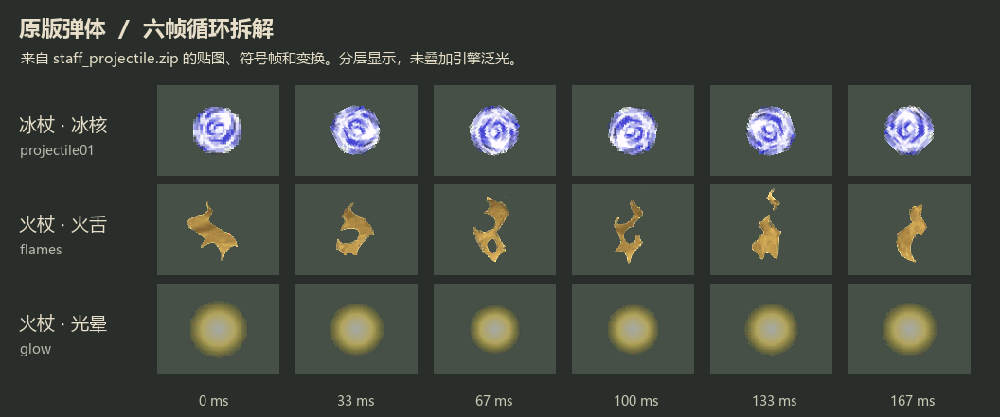

# 原版法杖弹体与粒子调研

研究范围是本机 DST 构建 **761239**。Lua 以 `data/databundles/scripts.zip` 为准，动画数据读自 `data/anim`。本机解包的 `data/scripts` 有部分文件与压缩包不同。以下逐帧图用于研究原版素材；Mod 的弹头、外围、尾焰造型仍待评审。

图中采用 `staff_projectile.zip` 的 `anim.bin` 帧序列、符号变换、`build.bin` 顶点与贴图 UV，以及原版 KTEX。三行分别绘制一个符号，固定观察中心和缩放比例。实际游戏还叠加层级、泛光、环境光、相机投影和运动；图中未模拟这些渲染效果。

## 三类原版投射物

| 样本 | 飞行中实际发生的变化 | 对本次问题的意义 |
|---|---|---|
| 普通冰杖 | `ice_projectile` 的 `ice_spin_loop` 是 30 fps、6 帧、0.20 秒的循环。六帧都使用 `projectile01` 的第 0 张图，主要变化是旋转矩阵。这个预制物没有持续发射尾粒的代码。 | 很少的素材也可以有明显运动感。需要弹头本身具有看得出旋转的纹样。 |
| 普通火杖 | `fire_projectile` 的 `fire_spin_loop` 同为 30 fps、6 帧。`flames` 依次换六种轮廓，`glow` 用同一张图随帧缩放；脚本另给火弹开启 bloom 和光照覆盖。 | 火焰的跳动来自火舌形状本身。光晕可以独立调节，无需把一整条尾焰画进弹头。 |
| 亮茄法杖 | `staff_lunarplant` 发射 `brilliance_projectile_fx`。`idle_loop` 为 30 fps、32 帧，使用 `pb_energy_loop`、`light_bar`、`glow`。脚本只给后两者加符号泛光，并把光条透明度设为 0.5。未命中有 18 帧 `disappear`，命中另生成 23 帧 `blast1/2` 并让受击目标短暂闪色。 | 飞行、消散、命中是三个美术时机。各层可以分别调亮度，命中闪光无需随飞行弹常驻。 |
| 熔炉活动火球 | `fireball_projectile` 自身播放 `idle_loop`。非专服端在投射物可见时，沿途新建无网络的尾段实体，播放 16 帧的 `disappear`，动画结束删除。尾段出生在弹头附近，初始前进速度为弹速的 20%～50%。 | 这是独立尾段的直接参考，但 `OnUpdateProjectileTail` 也会让所有存活尾段反复 `ForceFacePoint` 朝向当前弹头。该行为与“释放后的粒子不再看弹头”不同。 |

普通冰火杖的共用投射物速度设为 50。命中和飞行表现也各有分工。例如，冰杖打到不带 `freezable` 标签的目标才另外生成 `shatter`；火杖在目标有效且未处于燃烧状态时才额外生成 `fire_fail_fx`。熔炉火球使用活动专用服务端逻辑，应当在熔炉语境中理解。

## 一个原版粒子案例：嘉年华火炬

`torchfire_cawnival.lua` 在非专服端创建一个 `VFXEffect`，调用 `InitEmitters(3)`。三个通道各有自己的纹理、混合方式、颜色包络和尺寸包络。配置上限是单个发射器的容量，不代表每秒生成的粒子数。

| 通道 | 资源与混合 | 最大寿命 / 容量 | 观察到的行为 |
|---|---|---|---|
| 烟 | `fx/smoke.tex`，预乘透明混合 | 0.7 秒 / 64 | 向上飘、逐渐变大；透明度从零升高，再降回零。 |
| 火 | `fx/animsmoke.tex`，reveal shader，`AlphaAdditive` | 0.75 秒 / 64 | 使用旋转粒子，在生命期内缩小；这一层显式调用 `SetFollowEmitter(1, true)`。 |
| 余烬 | `fx/snow.tex`，加法混合 | 0.4 秒 / 128 | 随机初速、阻力 0.2，尺寸逐渐收至起始的约五分之一。 |

一个值得参考的细节是**余烬用的纹理文件名其实是 snow**。让它看起来像火星的，是偏暖的颜色包络、短寿命、收缩、运动与加法混合共同产生的效果。烟、火、余烬也不按同一个发射节奏出现。

Lua 通过 `EmitterManager:AddEmitter` 注册更新函数，按游戏 tick 和发射率累计要发的数量。创建单颗粒子时传入寿命、出生位置和初速度，旋转粒子还可传初始角度、角速度。颜色和缩放包络描述整个生命期。管理器区分唤醒和休眠实体，实体删除时移除发射器。火炬例子在专服提前返回，纯显示工作由客户端承担。

**坐标口径要单独验证。** 原版 `pollen.lua` 同时计算世界坐标来查询地形，但给 `AddParticle` 的是相对发射器的偏移。这两个坐标不能混用。火炬的火层显式启用跟随，烟和余烬没有这行代码；单凭这一点无法断定所有发射器默认如何处理父实体平移、旋转，以及父实体删除后粒子能否继续存活。

## 对三层结构的启发

1. **弹头与贴身外围**可以先借鉴冰、火杖的低帧循环或亮茄的分符号发光。需要实际对照的是，在游戏显示尺寸下，旋转同图、换轮廓和光晕呼吸各自能读出多少差异。
2. **尾焰**可以参考熔炉的“沿途生成、独立消失”，同时去掉旧尾段朝向弹头的持续修正。如果使用 `VFXEffect`，优先验证独立于投射物寿命的本地发射器，按它自己的坐标系换算出生位置。静止粒子初速为零；惯性粒子只在出生时采样一次弹速。
3. **下一步只需做原版机制对照**。用一张中性试验纹理，在固定镜头下观察移动、直角转向和移除弹头。标记同一粒子，分别检查它是否被平移、是否被转动、是否能独立淡出。通过这个对照后，再谈六种法术各自用什么形状、粒子密度和亮度。

## 核查入口

- 武器绑定与普通弹体：`scripts/prefabs/staff_common.lua` 的 `fns.red / fns.blue`，`scripts/prefabs/staff_projectile.lua` 的 `common / ice / fire`；动画包 `staff_projectile.zip`。
- 亮茄：`scripts/prefabs/staff_lunarplant.lua`、`scripts/prefabs/brilliance_projectile_fx.lua` 的 `fn / OnHit / OnMiss`；动画包 `brilliance_projectile_fx.zip`。
- 熔炉：`scripts/prefabs/fireball_projectile.lua` 的 `CreateTail / OnUpdateProjectileTail / MakeProjectile`；动画包 `fireball_2_fx.zip`。
- 粒子：`scripts/prefabs/torchfire_cawnival.lua` 的 `InitEnvelope / common_postinit`，`scripts/prefabs/pollen.lua` 的 `emit_fn`，`scripts/emitters.lua` 的 `EmitterManagerClass:PostUpdate`。
- Klei 的公开 Mod 说明提供官方开发资源入口，以上具体参数均来自本机安装包。[Klei 官方 Mod 说明](https://support.klei.com/hc/en-us/articles/360029555992-Modding-Don-t-Starve-and-Don-t-Starve-Together)
