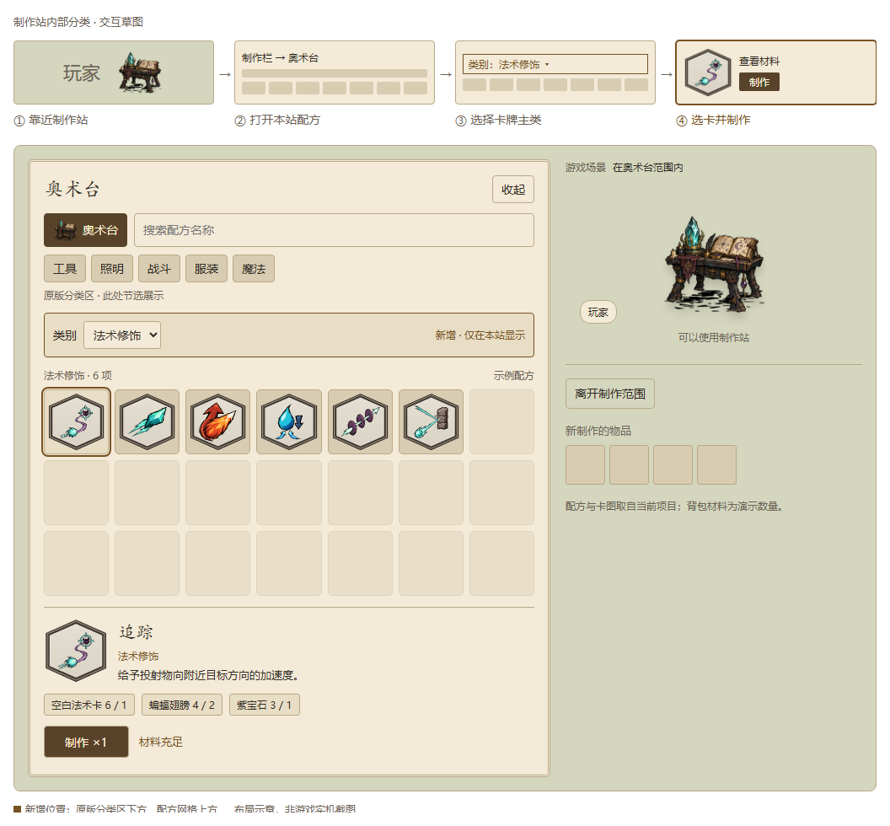

# 制作栏主类筛选：实现与兼容边界

归档日期：2026-11-07（Asia/Shanghai）。用于当前聊天归档后的开发交接。

后续标签词表、两行单选和逐卡核查的最终规则见[第25号交接](25_法杖编辑与标签筛选最终方案_会话归档.md)。本文件继续保留第一版主类筛选的实现背景与兼容边界。

**本聊天完成的是第一版“本站主类单选筛选”。归档时工作区已有后续标签扩展，不能把第一版说明当作当前完整行为，也不要按第一版回退后续代码。** 本次归档只整理文档与参考材料，没有重新安装或发布 Mod。

## 1. 用户确认的方案

新卡牌体系以一个主类确定身份，以标签描述形态、机制和用途。制作栏原来的“远程投射物／弹道修正／法杖修正／音符法术”等占位标题混合了多个分类维度，占用配方格子；决定移除，不再维护一套平行分类。

用户明确不希望向原版分类栏一次增加多个全局分类，最终授权：

- 仅在奥术台或武器刻印台的配方页启用主类筛选。
- 退出该页面时恢复原界面。
- 保留原版搜索，不新增全局分类。
- 移除旧分类占位图标；关闭新筛选时也不恢复这些占位配方。
- 提供一个默认开启、玩家可以自行关闭的本机设置，用于处理潜在 Mod 冲突。

主类沿用 [第 20 号分类规范](20_法术卡分类与视觉设计规范.md)：基础法术、法术修饰、施法控制。“全部配方”是清除主类限制的选项，不是第四个主类。

## 2. 启用条件与玩家流程

同时满足以下条件才启用：制作栏已打开；当前分类为原版 `CRAFTING_STATION`；原版 `builder:GetCurrentPrototyper()` 返回有效的 `nw_workbench` 或 `nw_engraver`。

| 玩家操作或状态 | 行为 |
| --- | --- |
| 仅靠近建筑，没有打开制作栏 | 不启用 |
| 在建筑附近查看工具、照明等原版分类 | 不启用 |
| 打开奥术台／刻印台的本站配方页 | 显示本站筛选控件 |
| 选择主类 | 缩小本站卡牌列表；材料和法杖在未限制标签的“全部配方”中显示 |
| 点选配方并制作 | 继续使用原版配方详情、材料判断和制作流程 |
| 输入原版搜索 | 原版切换到“全部”分类，本站筛选停用 |
| 切换分类、离开当前工作站、建筑失效或关闭制作栏 | 隐藏控件，撤销本功能的布局与焦点调整 |

判断依据是原版认定的**当前可用工作站**，不能只扫描附近有没有建筑；两座工作站靠在一起时尤其要避免误判。

原版搜索缓存可能在重新选中工作站后仍保留旧文字。启用判断应看当前分类页，不应额外要求内部 `search_text` 为空；第一版独立服务器检查曾发现并修正这一问题。不要为了筛选功能改写原版搜索语义。

## 3. 第一版与归档时源码快照

| 项目 | 本聊天第一版完成时 | 归档时观察到的后续实现 |
| --- | --- | --- |
| 源码版本 | 0.25.15 | `mod/modinfo.lua` 为 0.25.16 |
| 主类控件 | 原版 Spinner 左右切换，四个选项 | 独立控件封装；主类选项按本站完整配方目录生成，不显示本站不存在的主类 |
| 标签 | 第一版未实现 | 当前界面为单标签选择：选另一标签替换，再点已选标签取消 |
| 筛选状态 | 两种工作站分别保留本次会话的主类选择 | 在一次制作栏打开期间按工作站／主类管理；关闭制作栏后清空选择 |
| 筛选区高度 | 40 单位 | 116 单位，含主类与两行标签；以当前源码为准 |
| 设置名称 | 制作栏主类筛选 | 制作栏分类与标签筛选 |
| 设置键 | `crafting_class_filter` | 保持不变 |

后续实现入口是 [`nw_craftingfilters.lua`](../mod/scripts/widgets/nw_craftingfilters.lua) 和 [`card_tags.lua`](../mod/scripts/nw/card_tags.lua)，不是本聊天最初的静态草图。

**归档时需注意的文案差异：** `modinfo.lua` 悬停说明仍写“多选标签须同时满足”，筛选底层也支持传入多个标签取交集，但当前界面回调明确实现的是单标签替换／取消。后续接手应核对这处文案与当前设计，不要仅凭说明或日志中的“AND tags”认定界面支持多选。本次归档没有修改这部分运行时代码。

归档时读取的本机安装目录 `modinfo.lua` 仍标为 0.25.15，工作区则是 0.25.16。不能因此宣称最新工作区已经完整安装；继续实机测试前使用受保护安装脚本同步并验证。

## 4. 代码位置与维护边界

| 内容 | 入口 |
| --- | --- |
| 本机设置，默认开启 | [`mod/modinfo.lua`](../mod/modinfo.lua) |
| 客户端安装入口与独立测试入口 | [`mod/modmain.lua`](../mod/modmain.lua) |
| 启用判断、主类／标签过滤、布局与焦点恢复 | [`crafting_filter.lua`](../mod/scripts/nw/crafting_filter.lua) |
| 当前筛选控件、标签排版和导航 | [`nw_craftingfilters.lua`](../mod/scripts/widgets/nw_craftingfilters.lua) |
| 卡牌主类；与边框共用数据 | [`card_visuals.lua`](../mod/scripts/nw/card_visuals.lua) |
| 当前标签数据 | [`card_tags.lua`](../mod/scripts/nw/card_tags.lua) |
| 真实配方目录与注册 | [`acquisition.lua`](../mod/scripts/nw/acquisition.lua)、[`crafting.lua`](../mod/scripts/nw/crafting.lua) |
| 工作站加载时重建配方列表 | [`nw_workbench.lua`](../mod/scripts/prefabs/nw_workbench.lua) |
| 中英文控件文字 | [`locales/en.lua`](../mod/scripts/nw/locales/en.lua) |

必须保持的实现约束：

1. 通过 `GetModConfigData("crafting_class_filter", true)` 读取玩家本机选择。显式关闭时不注册这部分制作菜单钩子；专用服务器也不安装客户端 UI 扩展。改变设置后重新进入世界。
2. 不调用 `AddRecipeFilter` 增加全局分类，不修改全局分类表，不替代原版制作校验或新增制作用 RPC。
3. 过滤显示列表时保留原始来源，不反复从已过滤结果继续删减；保留原版排序，不漏掉恢复“全部配方”所需的条目。
4. 只在本功能筛掉选中配方时清空失效详情；不要改变其他原版页面的详情行为。
5. 鼠标和手柄都需要可达的筛选控件；操作筛选时不要被配方刷新抢走焦点。空结果必须仍可改变或清除筛选。
6. 进出页面不能累计位置或缩放误差；撤销自己的相对调整，避免覆盖其他 Mod 后来设置的位置和焦点。
7. 调整图片几何时使用局部 `GetLooseScale()`，不能把包含父级 HUD 缩放的 `GetScale()` 再写回局部比例。
8. 原版 HUD 的 `Open()` 在打开配方页之后才标记 `is_open=true`，要在该方法结束后同步激活状态。完全替换原版菜单、缺少所需结构时应保留其界面，不强行套用布局。

旧 `crafting_sections.lua`、相应旧测试及 `build_crafting_sections.py` 已移除。旧分类标题不再注册为配方，旧图集不再由 `modmain.lua` 加载。`acquisition.menu_entries` 当前直接引用真实 `recipes`；字段指南使用的历史分组仍可保留，但不再生成占位格子。

工作站 `craftingstation.nosave=true`，列表随建筑创建／加载重建。此改动不迁移卡牌编号、法杖属性或玩家存档。

## 5. 兼容性结论

原版有制作分类、工作站入口、搜索和 Mod 扩展接口，但**没有可直接配置出来的“本站主类＋标签”完整界面**。本站配方页仍使用公共制作菜单，局部启用只能缩小影响范围，不能保证零冲突。

风险主要集中于同时替换制作菜单、改变配方过滤、改动相同布局或焦点导航的 Mod，以及原版更新。普通物品／角色内容 Mod 的直接交集通常较少，但没有做逐项兼容认证。

排查顺序：在本机关闭此设置并重进世界，确认是否恢复；再核对具体冲突 Mod、HUD 缩放、输入设备和页面切换方式。关闭筛选仍应能正常制作全部本站配方。

## 6. 第一版验证记录与证据

以下是**本聊天第一版完成时**的结果，不是对归档时所有后续改动重新执行的验收：

- `test_crafting_filter.lua`、`test_modinfo.lua`、`test_locale.lua`、`test_acquisition.lua` 专项通过；覆盖本机关闭时零 UI 钩子、工作站／页面边界、分类恢复、原版排序与搜索、空列表、手柄焦点和反复进出。
- Lua 5.1 语法检查通过；本地化检查通过，当时为 718 条翻译、186 张双语目录卡。
- 独立游戏服务器验证通过：166 个真实工作站配方；确认配方注册、工作站学习列表、主类计数、激活判断和原版全局搜索。不是客户端显示验收。
- 全量 Lua 回归：64／70 通过。其余 6 项在内存恢复旧 `acquisition` 占位目录逻辑后仍以相同错误失败，未借本任务修改无关机制。
- 第一版已用 `tools/install_mod.py` 同步至 `E:/SteamLibrary/steamapps/common/Don't Starve Together/mods/nw_weave_dev`；当时校验 229 个文件、更新 14 个文件，版本仍为 0.25.15。

第一版全量结果已留不可混淆的归档副本：[first-implementation-regression.json](previews/crafting-filter-v1/first-implementation-regression.json)。失败项如下：

| 测试 | 当时失败信息 |
| --- | --- |
| `test_expansion.lua` | 旧卡牌数量断言 |
| `test_inventory_hint.lua` | 卡牌说明／属性断言 |
| `test_motion.lua` | 测试环境缺少 `SpawnPrefab` |
| `test_permanent_motion_cleanup.lua` | 测试对象缺少 `AnimState` |
| `test_rules.lua` | 数量断言 `219 ~= 215` |
| `test_spell_lab.lua` | 旧卡牌数量断言 |

原来的 [`server_smoke_crafting.log`](../test_reports/server_smoke_crafting.log) 是会被后续测试覆盖的文件。归档时其通过信息已经包含标签交集，不能把它当成第一版原始日志。当前控件还有 [`test_craftingfilters_widget.py`](../tests/test_craftingfilters_widget.py)；本次文档归档未重新执行这些后续测试。

## 7. 下一次继续工作的入口

先阅读本文件第 3 节，再核对当前源码与安装版本。需要运行时可使用：

```powershell
.\.venv\Scripts\python.exe tools/run_tests.py
.\.venv\Scripts\python.exe tools/check_localization.py
.\.venv\Scripts\python.exe tools/smoke_server.py --crafting --fresh --seconds 60
.\.venv\Scripts\python.exe -m unittest discover -s tests -p test_craftingfilters_widget.py
.\.venv\Scripts\python.exe tools/install_mod.py
```

完整回归脚本会在第一个失败处停止；不要将“未继续执行”记为后面的测试通过。独立测试目录不等于主开发 Mod 安装；安装脚本在游戏运行时会拒绝覆盖，应退出游戏后执行。

客户端实机尚需检查：

- 默认开启、关闭后重进；两名玩家使用不同本机设置。
- 两座工作站的进入、切换、离开和销毁；原版分类与搜索切换。
- 当前主类与单标签的选择、取消、空结果恢复、关闭制作栏后的重置。
- 实际制作与材料扣除；“全部配方”中材料、法杖仍可制作。
- 中文／英文、HUD 缩放、不同分辨率、鼠标与手柄；检查遮挡、截断和焦点。
- 与具体制作菜单 Mod 组合，确认关闭设置能恢复普通制作。

没有客户端实机截图或用户反馈前，不把逻辑测试、字体测量或原型预览称为实机验收。

## 8. 历史设计参考

下图是本聊天最初的 HTML 交互原型截图，展示“靠近制作站 → 打开本站配方 → 选择主类 → 选卡制作”。它使用项目卡图和示例材料数量，**不是游戏截图**；最初画了下拉选择，第一版实际使用原版左右切换控件，后续又加入标签。



不要依据这张历史草图覆盖当前 UI。收藏册的完整分类／标签设计另见 [收集册会话交接](21_法术收集册设计与会话交接.md)。
